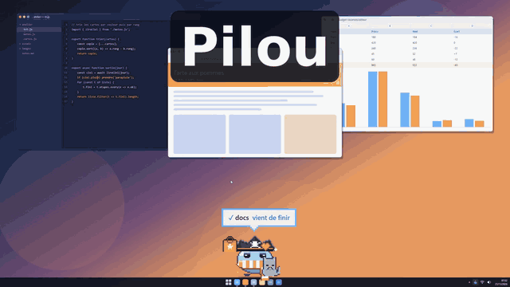

# Pilou — ton petit compagnon de bureau

<p align="center">
  
</p>

<p align="center">
  <a href="docs/promo/pilou-promo.mp4?raw=1"><b>▶ Télécharger la vidéo (720p, son)</b></a> ·
  <a href="docs/promo/pilou-promo-vertical.mp4?raw=1">format téléphone</a> ·
  <a href="https://github.com/EveCrystali/Compagnon/releases/latest">dernière version</a>
</p>

Pilou est avant tout un **petit animal de compagnie de bureau** : une goutte d'encre bleue en pixels
qui vit en bas de ton écran, comme pour te soutenir pendant que tu travailles. Il mène sa petite vie
dans son coin sans te déranger (jamais pendant que tu tapes), joue, mange, pêche, cuisine… et grandit
au fil de tes journées. Tout le reste est optionnel : de quoi le personnaliser et le faire vivre.
Gratuit, sur Windows et Android, avec une progression partagée entre PC et téléphone.

- **vit en bas de l'écran sans déranger** : petites réactions discrètes, il bouge moins quand tu travailles ;
- **grandit pendant que tu travailles** : niveaux, évolutions, titres ;
- **hauts faits, mini-jeux, quêtes, expéditions** : il joue, pêche, cuisine, part à l'aventure ;
- **boutique et ensembles** pour le personnaliser ;
- **rend visite à tes amis** ;
- et au passage, **il se branche à tes applis** : il te prévient quand une IA t'attend (Claude Code,
  Codex), relaie Discord, ta musique, ton agenda, tes mails, GitHub, la météo… et s'anime avec
  ([voir plus bas](#le-petit-plus--il-se-branche-à-tes-applis)).

## Installer (Windows 10/11)

Dans PowerShell :

```powershell
irm https://raw.githubusercontent.com/EveCrystali/Compagnon/main/installer.ps1 | iex
```

Rien d'autre à installer (.NET est inclus). Dépôt privé : télécharger `installer.ps1` et
`PilouBureau.zip` depuis la page des releases (connecté à GitHub), les mettre dans le même dossier,
puis clic droit sur `installer.ps1` → Exécuter avec PowerShell ; ou, avec `gh` connecté, lancer le
script tel quel. L'installateur pose l'overlay dans
`%USERPROFILE%\.claude\compagnon\bureau\`, ajoute le mod si Claude Code est là, branche Codex s'il est
là, et lance Pilou avec Windows. Le relancer met tout à jour. Options : `-SansCodex`, `-SansClaude`,
`-SansDemarrage` (télécharger le script, puis `.\installer.ps1 -SansCodex`).

À la main, si tu préfères :

```powershell
claude plugin marketplace add EveCrystali/Compagnon
claude plugin install compagnon@pilou --scope user
# overlay : PilouBureau.zip de la dernière release, décompressé dans %USERPROFILE%\.claude\compagnon\bureau\
```

## Sur Android

`Pilou.apk` (dans la release) : une vraie app à quatre onglets — **Accueil** (Pilou, niveau, état du
PC, sessions), **Jouer** (le jeu de tir **Chasse aux bugs**, pêche, cuisine, petits jeux),
**Collection** (carnet, recettes, récompenses, style) et **Réglages** — plus la notification
permanente, le widget et Pilou flottant par-dessus les applis. Les gains des jeux sont crédités au PC. Appairage par QR code depuis le PC (clic
droit → Intégrations → Android), échanges chiffrés de bout en bout. Détails et tableau de ce qui est
sur le téléphone : [docs/ANDROID.md](docs/ANDROID.md).

## Le petit plus : il se branche à tes applis

En bonus, et seulement si tu le veux, Pilou se branche à tes applis pour relayer ce qui mérite ton
attention et adapter ses animations, sans jamais crier. Beaucoup sont déjà prises en compte (IA de code,
Discord, musique, agenda, mail, GitHub, météo…, voir [Connecteurs](#connecteurs)) ; pour les autres,
l'[API locale](docs/API.md) suffit. Ce qui compte (une IA qui t'attend, « ✓ fini ») passe toujours, même
quand il se fait discret. Sa bulle te dit par exemple quelles sessions réfléchissent, ont fini ou
t'attendent :

```
 ❗ Claude · refonte-auth     attend ton autorisation
 ◐ Codex · mon-api            shell · 12 s
 ✓ Claude · docs              fini · il y a 3 min
```

## Ce qu'il suit

| Source | Comment | Ce que dit la bulle |
|---|---|---|
| Claude Code (app, terminal) | le mod `compagnon` | titre de la session, outil en cours, autorisation, question, fini, erreur |
| Codex (CLI, app, extension) | hooks dans `~/.codex/hooks.json`, posés par Pilou | `Codex · dossier`, outil, autorisation, fini |
| tout le reste | `PilouBureau.exe --signal …` ou un fichier JSON | ce que l'outil signale |

Brancher un autre logiciel (Cursor, Gemini CLI, un script, ta CI) : [docs/BRANCHER.md](docs/BRANCHER.md).

Idées gardées pour plus tard (petits jeux, notifications, vidéo) : [docs/IDEES.md](docs/IDEES.md).

## Connecteurs

Clic droit → **Connecteurs…** : tout ce qui nourrit Pilou au même endroit. Chaque connecteur a un
interrupteur, un état signé (● actif, ◌ à configurer, ✕ erreur, ○ coupé), ses réglages, son dernier
événement ; un journal garde les 50 derniers. Le mod Claude n'est plus qu'un connecteur parmi
d'autres : Claude Code, Codex, activités, statut Discord, webhook, téléphone, groupe d'appareils
(inchangés, simplement réunis), et la **météo**.

- **API locale** : `http://127.0.0.1:47821`, jeton obligatoire, refusée aux pages web et au réseau.
  Un script envoie `POST /evenements` (« build fini », « nouveau mail »), lit `GET /etat`. Exemples
  curl et PowerShell, et comment écrire un connecteur en un fichier : [docs/API.md](docs/API.md).
- **Secrets** (jetons des connecteurs) : chiffrés par Windows (DPAPI) dans `secrets.bin`,
  jamais en clair dans `reglages.json`.
- **Services** (coupés tant que tu ne les coches pas, mode d'emploi pas à pas dans chaque carte et dans
  [docs/CONNECTEURS.md](docs/CONNECTEURS.md)) : **Discord** par un bot à toi (mentions, salons
  suivis, salon de sortie ; jamais de selfbot), **GitHub** (revues, commentaires, CI, PR fusionnées),
  **Mail** IMAP (expéditeur et sujet seulement, Pilou facteur), **Agenda** ICS (rappel avant une
  réunion, Pilou se cache pendant, quête « ponctuel »), **Spotify** (Pilou danse au tempo du morceau),
  **Twitch** et **YouTube** (lives, nouvelles vidéos), **Home Assistant** (entités choisies). Les
  5 dernières nouvelles s'affichent aussi sur l'Accueil de l'app Android (titre seul en option).

## Météo

Connecteur **Météo** (coupé tant qu'aucune ville n'est choisie) : taper sa ville, *Chercher la
ville* ; Pilou relève le temps toutes les 15 minutes chez [Open-Meteo](https://open-meteo.com/)
(gratuit, sans compte). Dégagé ☀, nuageux ☁, pluie et averses ☂, orage ⚡, neige ❄, brouillard ≋,
vent fort ≈, chaleur ☼ (plus de 28 °C), froid ✻ (moins de 3 °C).

- **Sous la pluie**, sans parapluie ni imperméable, Pilou est trempé : gouttes, flaque, frissons,
  grimaces et bulles râleuses (« personne n'a pensé au parapluie ? »). Avec, il reste au sec, content,
  et une quête bonus du jour « reste au sec » rapporte des po. Le parapluie s'invite dans les offres
  de la boutique les jours de pluie.
- **Neige et froid** : sans bonnet, écharpe ou moufles, il grelotte sous le givre. **Canicule** :
  sans lunettes ni éventail, il sue. **Orage** : un éclair pâle de loin en loin. **Vent** : il tangue.
  **Brouillard** : voile. Les effets restent discrets : quelques gouttes ou flocons translucides, autour de Pilou
  seulement.
- **Objets** à acheter : imperméable (dos), bottes de pluie (nouvel emplacement *pieds*), moufles,
  éventail, parapluie étoilé (niveau 14), en plus du parapluie, de l'écharpe et du bonnet.
- **Téléphone** : carte météo sur l'Accueil ; Pilou y est mouillé (ou au sec) comme sur le PC, dans
  l'app, le widget et Pilou flottant.
- **Vie privée** : seule la ville choisie (puis ses coordonnées) part chez Open-Meteo ; aucune
  localisation automatique. Hors ligne, Pilou garde le dernier relevé. Réglage *Phrases* pour faire
  taire ses plaintes.
- Essayer sans attendre la pluie : `PilouBureau.exe --essai=meteo:pluie` (ou `meteo:pluie:parapluie`,
  `meteo:neige`, `meteo:chaleur`, `meteo:orage`).

## Clavier, captures d'écran, notifications

Clic droit → **Clavier, photo, notifications** (trois cases) :

- **Tu tapes en rafale** : pouf de fumée, Pilou tourne lentement sur lui-même et réapparaît assis devant un mini
  clavier ; il tape avec toi, puis range tout après quelques secondes de calme, et se repose 10 min avant la
  séance suivante. Le crochet clavier ne fait que **compter** les frappes, jamais lesquelles.
- **Tu fais une capture d'écran** (Impr. écran, Win+Maj+S, Win+Impr. écran) : il sort son appareil, petit flash
  pâle, « CLIC ! », un polaroïd tombe (une photo toutes les 2 min au plus). L'image n'est jamais lue.
- **Notifications Windows dans sa bulle** (coupé par défaut ; filtre d'applis, mode « 1 message de X ») : prêt
  côté Pilou, mais Windows réserve cette lecture aux applis qui ont une identité de package, que Pilou n'a pas
  encore. Ce qui marche, ce qui manque et la vie privée : [docs/NOTIFICATIONS.md](docs/NOTIFICATIONS.md).

Essayer : `PilouBureau.exe --devant --essai=clavier` (ou `photo`, `notif`, `notif:masque`).

## Clic droit sur Pilou

- **Réglages** : taille, bulle détaillée ou compacte, thème, accessoire, couleur, promenade, jeux ;
- **Pêcher, Cuisiner, Carnet de pêche, Livre de recettes** : clique sur le bouchon quand ça mord
  (sinon Pilou ferre seul, avec bien moins de chance) ; 23 prises en cinq raretés, 30 recettes et des
  plats inventés à chaque fournée (`apps/PilouBureau/Butin.cs`) ;
- **Jouer → Défense du bureau** (niveau 5, aussi depuis l'icône près de l'horloge ; jamais tout seul) : une
  bande de l'écran au-dessus de la barre des tâches devient un jeu de tir. Pilou, en bas, suit la souris (ou
  ← → / Q D) et tire au clic ou à Espace ; les bugs de Chasse aux bugs arrivent en formation (blindés,
  diviseurs, moucherons, un Bug de prod toutes les 5 vagues), des fenêtres et des post-it servent d'abris,
  des bonus tombent (tir double, bouclier, ralenti). Échap, clic droit ou ✕ pour quitter ; pause si une
  autre appli passe en plein écran. Réglages : largeur de la bande, *réduire les flashs*. Gains bornés
  (30 xp et 10 po par partie au plus, 120 xp et 30 po par jour), record, quête « jeu », succès Pare-feu,
  Rempart (vague 10), Gardien. `--essai=defense` : Pilou joue seul. `apps/PilouBureau/Defense.cs` ;
- **Niveaux** : ils **ouvrent l'accès** — jeux (pêche niveau 2, tape m'en cinq 3, cuisine 4, Chasse aux
  bugs 5), rangées de la boutique (paliers 1, 5, 10, 15, 20, 30, 40, 50), stades d'évolution — et chaque niveau gagné
  rapporte des pièces d'or (20 + 5 × niveau). Les titres restent liés au niveau (honorifiques).
  Courbe : xp(n) = 25·(n−1)² (niveau 10 ≈ 2 000 xp, 25 ≈ 14 400, 50 ≈ 60 000) ; le niveau déjà
  atteint est gardé (« niveau acquis », partagé entre appareils), on ne redescend jamais.
  `apps/PilouBureau/Progression.cs` ;
- **Évolution** : Pilou grandit — Gouttelette (niveaux 1–9), Pilou (10–24), Pilou Nimbus (25–39), Pilou
  Astral (40+), noms provisoires. L'évolution se joue au premier lancement après le palier ; une
  *pierre de calme* (boutique) la retient ; *Forme affichée* choisit parmi les stades atteints ;
- **Quêtes** : 3 du jour (minuit), 3 de la semaine (lundi), 1 du mois, tirées pour chaque appareil
  (pêche, cuisine, jeux, caresses, présence, et, une fois vus : tours Claude/Codex, commits, tests,
  score de Chasse aux bugs, activités). Elles rapportent des **pièces d'or (po)** et un peu d'XP ; les
  trois du jour ouvrent un coffre, les jours d'affilée font une série. `apps/PilouBureau/Quetes.cs` ;
- **🛒 Boutique** (en tête du menu, gratuite, aucune vraie monnaie) : une boutique rétro rangée par
  **rayons** (Tête, Yeux, Cou, Dos, Main, Pieds, Compagnons, Effets, Couleurs, Décors, Bulles, Spéciaux),
  chaque rayon en **rangées de niveau** (1, 5, 10, 15, 20, 30, 40, 50) : le niveau ouvre la rangée, les
  pièces d'or achètent. 245 articles à collectionner (chapeaux, lunettes, sac à dos, ailes, jetpack, guitare,
  compagnons, auras, teintes, décors, cadres de bulle, **titres affichés**…) en six raretés (· commun, ◇ peu
  commun, ◆ rare, ✦ épique, ★ légendaire, ✺ mythique : un signe et une couleur), **dix ensembles** (Explorateur,
  Pâtissier, Astronome, Pirate des mers de café, Jardinier, Rétro-arcade, Hiver douillet, Plage, Nuit des
  frissons, Fêtes de l'hiver : porté en entier, un effet en plus ; complet, un titre), des articles **de saison**
  (⌛ jours restants ; hors saison, ils reviennent l'année suivante) et **de passage** (✧ trois jours par mois en
  vitrine), un **compteur de collection** dont les paliers offrent titres et cadres. Tout avoir demande des mois
  (environ un an de jeu régulier) ; un petit achat reste possible tous les jours ou deux. Vitrine d'offres du
  jour (une à -25 %, la même sur le PC et le téléphone), cabine d'essayage (*Essayer / Acheter / Porter*). Le menu affiche « Boutique (N nouveautés) », un petit
  sac apparaît près de Pilou quand une rangée s'ouvre ou qu'une offre attend, et le passage d'un palier
  ouvre « Rangées débloquées → Voir en boutique ». Un **bandeau** niveau / XP / po est en tête du menu,
  de la boutique et de l'info-bulle de Pilou. Rien de ce qui était déjà gagné n'est perdu ; pièces, objets
  et tenue sont partagés dans le groupe d'appareils. `apps/PilouBureau/Boutique.cs`, `FenetreBoutique.cs` ;
- **Partager l'XP entre PC…** : un dossier commun (OneDrive, partage réseau) ; chaque PC y écrit son
  fichier, le total fait les niveaux ;
- **Intégrations → Partager l'XP entre mes appareils** (sans dossier commun : PC perso et PC de
  travail, téléphone) : un code de groupe de 16 caractères, le même que celui du téléphone. Sur un
  autre PC : *Rejoindre un groupe* et taper le code. Chaque appareil publie son propre compteur d'XP,
  chiffré, sur le relais ntfy (à chaque gain, au démarrage, puis toutes les heures) et garde la plus
  grande valeur reçue de chacun des autres ; le niveau se calcule sur la somme. Un PC vu à la fois par
  le dossier et par le relais compte une fois ; l'XP gagnée dans l'atelier du téléphone compte une
  fois même si plusieurs PC l'ont reçue. *Appareils du groupe* : nom, XP, vu il y a… ; si le relais est
  bloqué (proxy d'entreprise), Pilou le dit (« relais injoignable ») ;
- **Intégrations** : brancher ou débrancher Codex · statut Discord « Joue à Pilou » (niveau, IA au
  travail ; fiche de l'appli : [docs/DISCORD-APP.md](docs/DISCORD-APP.md)) · me prévenir sur mon téléphone (webhook Discord, Slack ou ntfy) quand une IA attend
  depuis 30 s ou a fini un long travail, si je suis loin du PC ;
- **Amis…** : un code ami (`PILOU-XXXX-XXXX-XXXX`, distinct du code de groupe) à échanger avec
  quelqu'un ; amis actifs quand chacun a ajouté l'autre. Quand il s'ennuie (deux fois par jour au
  plus), ou sur *Aller voir*, Pilou prend son baluchon et va **rendre visite** à un ami en ligne :
  une pancarte « chez Léo · ↩ 14 h 20 » le remplace (clic : le rappeler), il raconte sa vie là-bas,
  joue avec l'autre Pilou et revient au bout de 5 à 10 min avec un petit cadeau. Ne partagés que
  son allure, son niveau et quelques anecdotes (cochable) ; tout est chiffré. Voir
  [docs/AMIS.md](docs/AMIS.md) ;
- **Connecteurs…** : voir plus haut (météo, services, API locale) ;
- **Démarrer avec Windows**, icône près de l'horloge, se cacher 10 min, redémarrer, quitter.

Pilou vit sans Claude : il garde son XP lui-même et joue même si aucune IA ne tourne.

## Soins

Une couche légère et passive : Pilou reste d'abord un compagnon qu'on regarde. Trois besoins baissent
lentement — **faim** (vide en un jour et demi environ), **propreté** (deux jours), **moral** (un jour
un quart) — et rien ne s'affiche tant que tout va bien : ni jauge, ni bulle qui réclame.

- Sous 30 %, une seule petite icône apparaît près de sa tête, de forme différente pour chaque besoin :
  ◒ un bol (faim), ✦ une étincelle (propreté), ♥ un cœur (moral). **Un clic dessus la comble** :
  nourrir prend le meilleur en-cas acheté (gâteau, soupe, pomme dorée ; ils remontent aussi un peu le
  moral), sinon des croquettes gratuites ; laver, c'est deux secondes de mousse ; le moral, un câlin.
- **♥ Prendre soin de Pilou** (clic droit, et sur l'Accueil du téléphone) comble tout d'un coup.
  Les caresses et les petits jeux remontent aussi le moral.
- Le même rythme pour tout le monde : il n'y a pas de mode de difficulté.
- Négligé (un besoin sous 20 % depuis six heures, ou deux à la fois), il **boude** ☁ : moue et sourcils
  froncés, petit nuage gris qui bruine, bras croisés s'il en a (Nimbus), le dos tourné de temps en temps,
  il traîne les pieds et lâche un « hmpf » de loin en loin. Tant qu'il boude, **tous ses gains d'XP et de
  po sont à × 0,6** (« Pilou boude : gains ×0,6 » dans l'infobulle et le menu *Soins*). Une fois soigné,
  il se laisse amadouer une demi-heure (le nuage s'éclaircit, la moue va et vient), puis se déride.
  C'est tout : ni maladie, ni fugue, rien de perdu. Bien soigné (les trois besoins au-dessus de 70 %),
  il **rayonne** : gains × 1,2.
- Au passage d'un stade (2 à 4), la qualité des soins des derniers jours choisit une **variante** :
  *câlin* (joues roses, petit cœur) ou *espiègle* (tache de rousseur en étoile, épi rebelle). Elle reste
  acquise et se partage entre appareils.
- Clic droit → *Soins* : l'état en chiffres (sur demande seulement) et le mode **vacances** (tout est
  figé, il ne boude pas). Une quête « Prends soin de Pilou » peut tomber.
- Partagé : chaque soin est une action datée avec un identifiant ; tous les appareils (dossier commun,
  groupe, téléphone) font l'union des actions et calculent le même état, qui ne dépend que d'une base,
  de ces actions et du temps passé. Les actions de plus de deux jours sont repliées dans la base, à une
  heure ronde. `apps/PilouBureau/Soins.cs`.

## Expéditions

Clic droit → **⚔ Partir en expédition…** (ou l'icône près de l'horloge) : un clic sur un lieu — Caverne des
câbles, Forêt des onglets, Tour du tampon, Marais des mises à jour, Citadelle du nuage, ouverts par le niveau — et
Pilou part seul, baluchon et épée en bois ; une pancarte « en expédition · ↩ 15 h 40 » le remplace (les sessions
restent dans la bulle). L'aventure se résout toute seule (combats contre des bugs géants, slimes de cache, golems
de tickets…, pièges, coffres, boss) : il rentre avec quelques po et un peu d'XP, parfois un butin introuvable en
boutique ou un trophée, parfois bredouille et cabossé. Un petit coffre près de lui ouvre le journal.

- **Énergie ⚡** (bandeau du menu et de la boutique, téléphone) : chaque départ en coûte ; elle remonte un peu
  toute seule (jusqu'à 50), **surtout en travaillant** (temps dans une appli de travail, IA qui finit, quête
  réussie) et en mangeant (plats cuisinés, en-cas de route de la boutique). Pilou boudeur : deux fois moins vite.
- **Mesuré** : 30 min de repos entre deux, trois par jour pour tout le groupe, pas pendant une visite ; en
  moyenne une journée rapporte de l'ordre d'une ou deux parties de pêche.
- Équipement léger (un outil, un talisman), téléphone en lecture, trois quêtes. Détails, chiffres d'équilibre et
  `--essai=expedition:depart|retour|defaite|journal` : [docs/EXPEDITIONS.md](docs/EXPEDITIONS.md).

## Activités

Pilou devine ce que tu fais d'après la fenêtre au premier plan, et en tire une tenue :
code, tableur, jeu (jeu de rôle en ligne à part), musique (il danse au rythme du son), vidéo,
lecture, dessin, visio, mail, écriture, diaporama, et la nuit après 23 h. Le temps passé fait monter
des **métiers** (Codeur, As du tableur, Joueur, Mélomane… de Novice à Légende) et débloque des
**succès** (Marathon : 4 h de code d'affilée, Noctambule, Visio-man, Explorateur…), avec de l'XP.

- **Discret** : il se cache tout seul en plein écran (jeu, vidéo), en présentation et en visio
  (caméra ou micro actifs), et revient ensuite. Une IA qui t'attend le garde visible, sauf en présentation.
- **Vie privée** : tout se passe sur le PC. Le titre de la fenêtre sert à reconnaître l'activité puis
  est oublié ; seuls des compteurs (« 3 h de tableur ») sont gardés. Clic droit → *Métiers et succès →
  Activités : réglages* : tout couper, ou activité par activité.
- **Tes logiciels** : *Ajouter mes logiciels…* ouvre `%USERPROFILE%\.claude\compagnon\activites.json`
  (programme, titre ou chemin → activité ; relu sans redémarrer). Règles par défaut :
  `apps/PilouBureau/activites.json`.

## Mises à jour

Rien à faire. Chaque fusion sur `main` publie une release (`v0.9.<n>`) avec `version.json`.
- **PC** : une minute après le démarrage puis toutes les 2 h, Pilou regarde la dernière release ; s'il y
  a du neuf, il la télécharge, met aussi à jour le mod Claude, et se relance (« nouvelle version… »
  dans sa bulle). Clic droit → *Version* : chercher maintenant, ou couper l'automatique.
- **Téléphone** : une fois par jour, l'app vérifie ; une notification « Pilou 0.9.n est disponible »,
  un appui, et Android demande de confirmer la mise à jour (la première fois, il faut autoriser Pilou
  à installer des applis). Bouton « Chercher une mise à jour » dans l'app.

À la main : relancer la ligne d'installation, ou `claude plugin marketplace update pilou` puis
`claude plugin update compagnon@pilou --scope user` et `/reload-plugins`.

## Si Pilou ne répond plus

Le menu clic droit ne s'ouvre plus, Pilou a disparu ou semble figé ? Trois portes de secours, qui ne
passent pas par lui :

- **L'icône de Pilou près de l'horloge** (zone de notification ; derrière la flèche ^ si Windows l'y a
  rangée) : clic gauche, il revient (même caché ou parti hors de l'écran) ; clic droit, un petit menu
  *Afficher / ramener Pilou · Ouvrir le menu de Pilou · Chercher une mise à jour · Redémarrer Pilou ·
  Quitter Pilou*. On peut la masquer (clic droit sur Pilou → *Icône près de l'horloge*).
- **Menu Démarrer → Pilou** (raccourci posé par l'installateur). S'il tourne déjà, ça ne crée pas un
  deuxième Pilou : le premier se montre ; s'il ne répond plus du tout, il est remplacé par un neuf.
  En ligne de commande : `PilouBureau.exe --redemarrer` l'arrête proprement et le relance.
- **Réinstaller** (garde l'XP, les réglages et la boutique), dans PowerShell :

  ```powershell
  iex ((irm https://raw.githubusercontent.com/EveCrystali/Compagnon/main/installer.ps1).TrimStart([char]0xFEFF))
  ```

Dans le **Gestionnaire des tâches**, il s'appelle **Pilou** (avec son icône), dans *Processus en arrière-plan*
(onglet *Détails* : `PilouBureau.exe`) : *Fin de tâche*, puis menu Démarrer → Pilou. Il n'est pas rangé
dans *Applications* : Windows n'y met que les programmes qui ont une fenêtre dans la barre des tâches, et
Pilou reste volontairement discret (ni barre des tâches, ni Alt+Tab).

## Tourner une vidéo de ton écran

Pour une vidéo de présentation avec de vraies images : `outils/tourner-ecran-gauche.ps1` filme **ton écran
de gauche** (et lui seul) pendant qu'un Pilou de démonstration, en grand, devant un **décor de bureau fictif**
(fond dégradé, fausses fenêtres, fausse barre des tâches : rien de ton bureau n'apparaît), y joue une visite
guidée d'environ 1 min 35 :
promenade, une IA qui attend, le vrai menu clic droit et ses sous-menus, la boutique, la fenêtre Amis, le
clavier, la photo, une visite chez Léo, la pluie, deux petits jeux, l'évolution, le menu de l'icône près de
l'horloge (et, si ta version les a, la Défense du bureau, les Expéditions et le rayon Ensembles). Active « Ne pas
déranger », puis, dans PowerShell (option `-SansDecor` pour filmer ton vrai bureau) :

```powershell
irm https://raw.githubusercontent.com/EveCrystali/Compagnon/main/outils/tourner-ecran-gauche.ps1 -OutFile "$env:TEMP\tourner-ecran-gauche.ps1"
powershell -ExecutionPolicy Bypass -File "$env:TEMP\tourner-ecran-gauche.ps1"
```

Le script montre l'écran choisi et demande confirmation, installe ffmpeg au besoin (winget), filme, remet ton
Pilou habituel et pose `pilou-ecran-gauche.zip` sur le Bureau (la vidéo et `chronologie.json` : début et fin de
chaque étape, si elle a été jouée, les rectangles à cadrer au montage, la version de Pilou ; `erreurs.txt` si
quelque chose a raté). La fenêtre PowerShell est réduite pendant le film. Le Pilou de démo ne lit que des
sessions, un profil et des amis **fictifs**, en mémoire : ton XP, tes po, tes objets, tes amis et tes réglages ne sont ni lus ni
modifiés. Ne touche pas à la souris pendant le tournage (elle bouge toute seule) ; pour arrêter : Alt+Tab vers
PowerShell, puis Échap.

## Pour contribuer

- `plugins/compagnon` : le mod Claude Code (TypeScript) — tests : `claude plugin test plugins/compagnon` ;
- `apps/PilouBureau` : l'overlay (WPF, .NET 9) — tests de la logique, sur tout OS :
  `dotnet test apps/PilouBureau/tests` ; compiler depuis Linux ou macOS :
  `dotnet build apps/PilouBureau -p:EnableWindowsTargeting=true` ;
- `android/` : l'app Android (Java, sans bibliothèque) — construite par GitHub Actions ;
- une release : fusionner sur `main` (ou pousser une étiquette `v…`) ; GitHub Actions fabrique
  `PilouBureau.zip`, `Pilou.apk`, `installer.ps1` et `version.json`.

Détail des comportements : [plugins/compagnon/README.md](plugins/compagnon/README.md).
