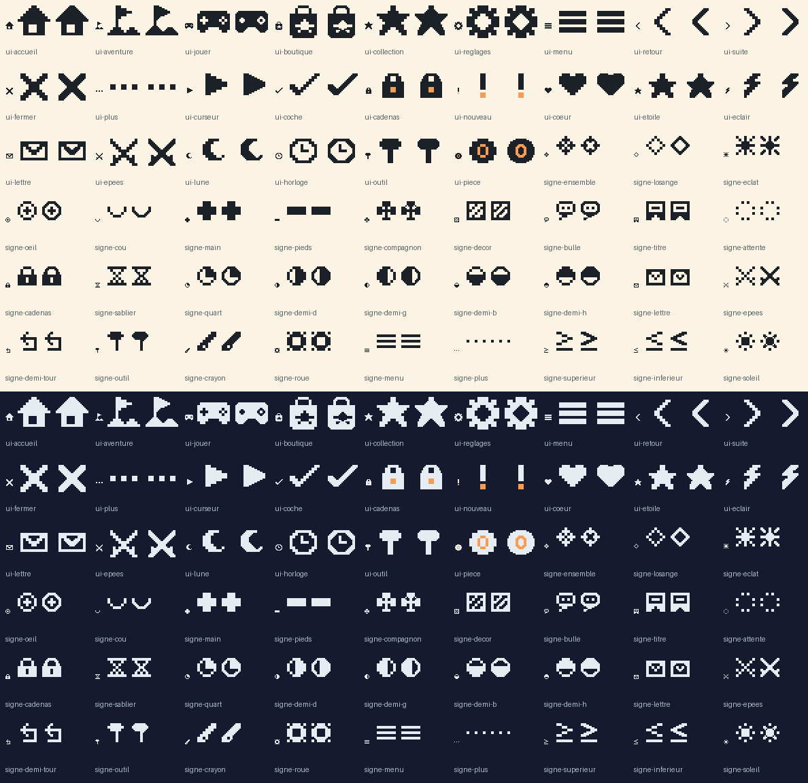
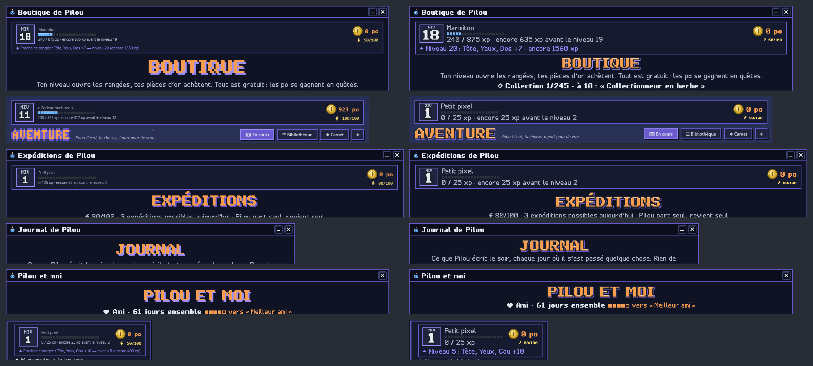
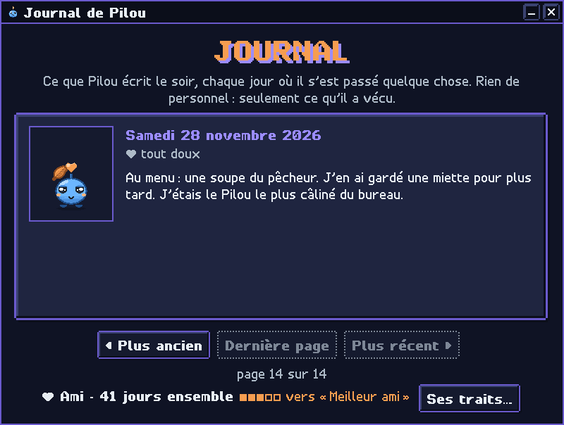

# La main de Pilou — guide de style des interfaces

Une seule écriture visuelle pour tout ce qui n'est pas la scène : fenêtres, menus, cartes, boutons, textes.
Le canon existe, il n'est pas inventé ici : **le menu « Sept portes »** du PC (`apps/PilouBureau/MenuRetro.xaml`,
planche [maquettes/menu/captures/sept-portes.png](maquettes/menu/captures/sept-portes.png)), **la bulle du bureau**
(`FenetrePilou.cs`, `BullePixel.cs`) et **le cadre de l'Aventure** (`CadrePixel`, [SCENES.md](SCENES.md)). Ce guide
les mesure et les écrit. Toute interface nouvelle s'y tient ; tout écart se discute ici d'abord.

| Planche | Image |
|---|---|
| Toutes les pièces, dessinées par le vrai code de l'app (clair) | [captures/style/planche-clair.png](captures/style/planche-clair.png) |
| Les mêmes, de nuit | [captures/style/planche-sombre.png](captures/style/planche-sombre.png) |
| Le jeu d'icônes (1×, à l'écran, dessin fin) | [captures/style/icones.png](captures/style/icones.png) |
| PC, taille réelle à 100 % : système, pixel « petit », pixel au plancher de lisibilité | [boutique](captures/style/pc-boutique-lisibilite.png), [« Pilou et moi »](captures/style/pc-traits-lisibilite.png) |
| Téléphone, avant / après le plancher de lisibilité | [boutique](captures/style/android-lisibilite-boutique.png), [collection](captures/style/android-lisibilite-collection.png) |
| PC avant / après à 100 % : boutique, journal, « Pilou et moi », expéditions | [boutique](captures/style/pc-boutique-avant-apres.png), [journal](captures/style/pc-journal-avant-apres.png), [« Pilou et moi »](captures/style/pc-traits-avant-apres.png), [expéditions](captures/style/pc-expeditions-avant-apres.png) |
| Android avant / après : Accueil, Jouer, Boutique, Collection | [clair](captures/style/avant-apres-clair.png), [sombre](captures/style/avant-apres-sombre.png), [grande police](captures/style/avant-apres-grande-police.png) |
| PC : titres-logos et en-tête commun, avant / après à 100 % | [captures/style/pc-titres-fins-avant-apres.png](captures/style/pc-titres-fins-avant-apres.png) |
| En-tête et barre du bas en grande police, avant / après | [captures/style/entete-barre-grande-police.png](captures/style/entete-barre-grande-police.png) |
| Réglages (clair, sombre, grande police) et premier lancement | [captures/style/reglages-et-premier-lancement.png](captures/style/reglages-et-premier-lancement.png) |


## Les six règles

1. **Tout est en pixels entiers.** Aucun arrondi lissé, aucun dégradé, aucune ombre floue, aucune mise à l'échelle
   non entière. Un coin « rond » est un coin **en escalier** : le pixel du coin manque.
2. **Un seul module.** Cadres, pointillés et marges se comptent en modules `U` (voir « Le module »).
3. **Une seule police : celle de Pilou** ([POLICE.md](POLICE.md)). La police système n'est permise que dans les cas
   listés plus bas.
4. **La forme d'abord, la couleur ensuite.** Chaque état porte un signe de forme (cadre, biseau inversé, coche,
   cadenas, pointillés). Jamais la seule couleur.
5. **Jamais rouge contre vert** (Antoine est deutéranope). Les accents sont le bleu, l'orange et le violet.
6. **Les signes de clavier sont remplacés par des icônes pixel** (voir « Icônes »).

## Le module

| Où | Valeur de `U` | Source |
|---|---|---|
| Menu du PC | 2 unités WPF (2 px à 100 %) | mesuré dans `MenuRetro.xaml` : bords, biseau, pointillés, curseur, coche sont tous dessinés par pas de 2 |
| Bulle du bureau | 3 unités WPF (bord et pointe en escalier) | `FenetrePilou.cs` : `BorderThickness = 3`, pointe `Pixels` de 3 |
| Fenêtre Aventure du PC | le pixel de la scène : 2 unités WPF en haute définition (480 × 240 à ×2), 5 pour une scène restée à l'ancien format (192 × 80 à ×5) | `CadrePixel.U`, [SCENES-HD.md](SCENES-HD.md), [SCENES.md](SCENES.md) |
| Autres fenêtres du PC (boutique, journal, « Pilou et moi », expéditions), leur habillage, leurs titres-logos, l'en-tête commun | 2 unités WPF | `StylePixel.cs`, `LogoPixel.cs`, `Bandeau.cs`, `HabillageFenetre.cs` |
| Téléphone, partout | le pixel de la scène : largeur de l'écran ÷ 192, entier (5 px à 1078 px de large, 3 px à 720) | `Aventure.unite`, repris par `Style.u` |

**Le cadre suit l'unité de ce qu'il entoure** : un cadre, un logo ou un en-tête posé autour d'une scène ou d'un contenu
prend son pixel, jamais un pixel plus gros (règle 9 de `CLAUDE.md` : le pixel art n'est jamais une baisse de
définition, et cela vaut pour l'habillage). **La police, elle, garde son plancher de lisibilité** : quand le pixel
s'affine, le texte ne rapetisse pas, il est dessiné plus fin (police « 2× »).

Sur le téléphone, l'interface a une seule taille de pixel, celle de l'ancienne scène de l'Aventure (largeur ÷ 192). La
scène en haute définition y est plus fine (2 px par unité sur un écran de 1078 px) : l'en-tête et la barre du bas sont
donc à reprendre au pixel fin, comme sur le PC (second temps, pas encore fait).

## Palette

Deux thèmes, mêmes rôles. Le thème suit le système sur le téléphone, le thème de Pilou sur le PC.
Les couleurs sont celles de `MenuRetro.cs` ; `page` et `creux` sont les deux seuls ajouts (le menu n'a pas de page).

| Rôle | Clair (crème) | Sombre (nuit) | Sert à |
|---|---|---|---|
| `page` | `#efe3cb` | `#0b0e1a` | fond d'écran derrière les cartes (ajout) |
| `carte` | `#fbf3e4` | `#151a2e` | fond d'un cadre, d'un menu |
| `creux` | `#e6d7b8` | `#2a3156` | cases vides d'une barre, fond d'un groupe d'onglets (ajout) |
| `texte` | `#1c2128` | `#e6ecf2` | texte courant, titres de carte |
| `pâle` | `#57606a` | `#adbac7` | détails, légendes, onglet au repos |
| `éteint` | `#767c84` | `#7d8796` | ce qui est fermé |
| `accent` | `#1f5fae` | `#f69d50` | survol du menu, appui, bouton principal |
| `sur accent` | `#ffffff` | `#151a2e` | texte posé sur l'accent |
| `bord` | `#2f7ed8` | `#6a5acd` | bord d'un cadre |
| `biseau clair` / `sombre` | `#ffffff` / `#d9c7a3` | `#3a4270` / `#0b0e1a` | biseau |
| `ombre` | `#1c2128` | `#0b0e1a` | ombre portée |
| `pointillés` | `#c86a1c` | `#6a5acd` | séparateurs, titres de section |
| `coche` | `#1f5fae` | `#6cb6ff` | ce qui est choisi, fait, en ligne |
| `titre` | `#6a4fc8` | `#9b8cff` | titres de section |
| `orange` | `#9c4a0a` | `#f69d50` | ce qui appelle le joueur, les pièces d'or |

- Tout texte tient un contraste d'au moins 4,5:1 sur `page` et sur `carte` (c'est pourquoi l'orange du thème clair
  est foncé : `#9c4a0a`).
- **Toujours de nuit, dans les deux thèmes** : l'en-tête (niveau, XP, pièces) et la boutique. Ce sont l'en-tête du
  menu du PC et la borne d'arcade ; ils prennent la palette sombre telle quelle.
- La bulle du bureau garde son bord bleu `#6cb6ff` : c'est la voix de Pilou, pas une carte.

## Le cadre

```
 .######################.        # bord (1 U), coins en escalier : le pixel du coin manque
 #++++++++++++++++++++++#x       + biseau clair (haut, gauche)   - biseau sombre (bas, droite)   (1 U)
 #+                    -#x       x ombre portée (1 U, en bas et à droite, en escalier elle aussi)
 #+       fond         -#x
 #+--------------------- #x
 .######################.x
  .xxxxxxxxxxxxxxxxxxxxxx.
```

| Sorte | Fait de | Sert à |
|---|---|---|
| **Plein** | bord 1 U + biseau 1 U + ombre portée 1 U | cartes, panneaux, fenêtres, réplique et choix de l'Aventure |
| **Fin** | bord 1 U + biseau 1 U, sans ombre | boutons, onglets d'un groupe |
| **Plat** | bord 1 U seul, coins en escalier | puces, étiquettes, cases d'état, onglet ouvert de la barre du bas, bulle |
| **Pointillé** | bord en pointillés (1 U allumé, 1 U éteint), ni biseau ni ombre | ce qui est fermé |

- Le contenu d'une carte se retire de 12 dp à l'intérieur du cadre (téléphone) ; 2 à 3 unités dans le menu du PC.
- Entre deux cartes : 14 dp. Marge de page : 18 dp de chaque côté.
- **Carte qui appelle le joueur** (« il t'attend ») : même cadre, le bord passe à l'orange, et le titre porte un signe
  (`!`, `●`, `★`).
- Le menu du PC d'origine a 2 px d'ombre tout autour au lieu d'une ombre portée : c'est le même cadre, vu avant que
  l'Aventure ne le pose sur le téléphone. Les nouvelles fenêtres du PC prennent l'ombre portée (`CadrePixel.cs`).

## Texte

La police est décrite dans [POLICE.md](POLICE.md) : « texte » et « titre » (gras), chacune avec son dessin fin (2×),
choisi quand un pixel de police tombe sur un nombre pair de pixels de l'écran.

| Taille | Téléphone (dp par pixel de police) | Sur 1078 × 2400 | PC | Sert à |
|---|---|---|---|---|
| **Petit** | 1,25 | 3 px | 1,3 unité (1 px à 100 %) | **capitales et nombres seulement** : étiquettes, prix, titres de section, « NIV » (voir « Plancher de lisibilité ») |
| **Corps** | 1,45 (4 ÷ 2,75) | 4 px | 2 unités (2 px à 100 %) | tout texte en minuscules : phrases, détails, légendes, récit, choix, boutons, titres de carte (en « titre ») |
| **Page** | 2,4 | 7 px | — | titre de page, nombre du niveau |

- La taille suit **la taille de police du système** (× 1,3 en « grande police »), puis s'arrondit au pixel entier.
- **Libellés rangés côte à côte** (barre du bas, groupe d'onglets) : ils prennent la plus grande taille qui laisse
  chaque nom dans sa case, avec 2 U d'air de chaque côté. En grande police, ils grandissent donc moins que le reste,
  mais ne se touchent jamais (`Style.pixelQuiTient`).
- **Un texte qui ne tient pas se reformule**, il ne se tronque pas. Quand la longueur dépend de l'écran, on écrit
  plusieurs formes, de la plus longue à la plus courte, et l'écran prend la première qui tient (`Style.choisir`) :
  « ▲ Niveau 15 : Tête, Yeux, Cou +9 · encore 1000 xp » → « ▲ Niveau 15 : Tête, Yeux, Cou +9 » → « ▲ Niveau 15 : 12 rangées ».
- Capitales : seulement les titres de section et les enseignes (« BOUTIQUE »). Le gras (« titre ») : titres et boutons.
- Enseigne secondaire (« ESSAYAGE », « RANGÉES DÉBLOQUÉES ») : police « titre », ombre d'un pixel de police en bas à
  droite. Le titre d'une fenêtre est un **titre-logo** (voir plus bas), pas une enseigne agrandie.

### Plancher de lisibilité

Un texte en pixels n'a pas de demi-taille : il fait 1, 2 ou 3 pixels d'écran par pixel de police. La plus petite taille
ne sert donc pas au texte courant. Mesuré à 100 % sur ce qui se lit bien :

| Référence | Police | Hauteur d'x (minuscules) | Hauteur des capitales |
|---|---|---|---|
| Menu « Sept portes » | Consolas 12,5 | 7 px | 9 px |
| Bulle du bureau | police pixel, 1 px par pixel | 5 px | 7 px |
| Police pixel « petit » (1 px par pixel) | — | 5 px | 7 px |
| Police pixel « corps » (2 px par pixel) | — | 10 px | 14 px |

**La règle, sur le PC** : aucun texte courant sous **7 px de hauteur d'x** à 100 % (celle du menu). En police pixel :

- tout texte qui contient des minuscules est en **« corps »** au moins (hauteur d'x 10 px) ;
- **« petit » est réservé aux étiquettes en capitales et aux nombres** (prix, « NIV 15 », « À TOI », onglets, titres de
  section, enseignes secondaires) : en capitales, il fait 7 px de haut, la hauteur d'x du menu. `StylePixel.Etiquette`
  met en capitales et en police « titre » ;
- une fenêtre grandit avec son texte : on élargit les cases et la fenêtre, on ne rapetisse pas la police.

**La règle, sur le téléphone** : aucun texte en minuscules sous le **« corps »** (hauteur d'x de 20 px sur un écran de
1078 × 2400, soit 7,3 dp ; « petit » n'en fait que 15, soit 5,5 dp). « Petit » y est réservé de la même façon aux
capitales (`Style.etiquette`, titres de section, « NIV »). Des libellés rangés côte à côte qui ne tiennent pas au corps
passent en police « texte » plutôt qu'en « titre » (plus étroite) avant de rapetisser, et jamais sous « petit ».

**Un bouton fermé reste lisible** : son texte éteint (`#7d8796`) tient **4,7:1** de contraste sur le fond de nuit
(`#151a2e`), au-dessus du seuil de 4,5:1 ; il garde la taille du bouton ouvert. Le bord en pointillés dit l'état, la
couleur ne fait que l'accompagner. En thème clair, l'éteint `#767c84` ne fait que 3,8:1 sur la carte crème : un texte
fermé y prend la couleur `pâle` (`#57606a`) et garde ses pointillés.

À trancher : **la bulle du bureau est sous ce plancher** à 100 % (hauteur d'x de 5 px). Elle se lit parce que ses
phrases sont courtes et isolées ; la passer à 2 px par pixel doublerait sa taille à l'écran.

### Où la police système reste permise

| Cas | Pourquoi |
|---|---|
| Un caractère que la police de Pilou n'a pas (emoji, alphabet non latin) | il est écrit par le système dans sa case de 6 pixels ; le reste de la phrase reste en pixels |
| Les champs de saisie (code d'appairage, adresse du relais, prénom) et le clavier | ce sont ceux du système ; le champ garde un cadre plat en pixels, dans le creux |
| Les notifications, le titre de la fenêtre, l'écran de la barre des tâches | le système les dessine |
| Les fenêtres pas encore converties | état provisoire : voir « Où en est-on » |

`TextesSystemeTest` parcourt chaque écran du téléphone passé au guide et échoue, liste à l'appui, dès qu'un texte y
est écrit en police système hors de ces exceptions. Un texte dessiné à la main sur une toile (`Canvas.drawText`) lui
échappe : il se cherche à la relecture.

Le récit de l'Aventure, lui, est **en police pixel** (décision du 28 novembre 2026, `DECISIONS.md`) : à 4 px par
pixel de police sur un téléphone, il reste lisible. Ce guide n'ouvre donc pas d'exception « long texte ».

## États

Le canon est la ligne du menu : au repos, texte sur fond ; survolée, **fond d'accent, texte inversé et curseur ▶** ;
choisie, **coche ✓** (case) ou **rond à point** (choix exclusif) ; fermée, **texte éteint, sans curseur**.
Un écran tactile n'a pas de survol : l'appui le remplace.

| État | Bouton principal | Bouton secondaire, carte | Onglet, option | Signe de forme |
|---|---|---|---|---|
| **Repos** | fond d'accent, texte inversé, biseau en relief | fond de carte, cadre fin (ou plein pour une carte) | texte pâle, sans cadre | — |
| **Survol** (PC) / **appui** | le biseau s'inverse : le bouton s'enfonce | fond d'accent, texte inversé, plus d'ombre portée | idem | biseau inversé, curseur ▶ sur le PC |
| **Choisi** | — | bord à la couleur `coche` | cadre plat à la couleur `coche` autour de lui | le cadre, la coche ✓, le rond à point |
| **Fermé** | texte éteint (4,7:1 sur le fond de nuit), même taille, cadre en pointillés | idem | idem | pointillés (et cadenas quand c'est un niveau qui ferme) |

Les états d'une chose (quête, session, objet) se disent par une **case** : un carré au cadre plat avec un signe.

| Signe | Sens | Couleur d'appoint |
|---|---|---|
| ✓ | fait, à toi | `coche` |
| ○ | à faire | `pâle` |
| ! | attend le joueur | `orange` |
| ◐ ◒ | en cours | `coche` |
| cadenas | fermé | `éteint` |
| ★ ◆ ◇ ✦ ✺ | raretés | celle de la rareté |

## Titres de section, pointillés, puces

- **Titre de section** : petites capitales, police « titre », taille petit, couleur `titre`, puis des **pointillés
  jusqu'au bord** (3 U après le texte). Menu du PC : marge 9 / 7 / 8 / 2. Téléphone : 12 dp au-dessus, 6 dp au-dessous.
- **Pointillés** : carrés de 1 U, un allumé, un éteint, couleur `pointillés`. Ils séparent deux lignes d'une même
  carte (6 dp au-dessus et au-dessous) ; jamais de filet plein.
- **Puce** (un mot d'état : « ● PC en ligne ») : cadre plat à la couleur de l'état, fond de carte teinté à 12 %,
  texte « titre » petit, toujours avec un signe devant.
- **Barre de progression** : cases de 3 U séparées de 1 U, hautes de 4 U (3 U dans l'en-tête) ; pleines en bleu, la
  dernière pleine en orange, les vides en `creux`. Jamais de barre lisse.

## Réglages : lignes, cases, options, curseur

| Pièce | Règle | Code |
|---|---|---|
| **Ligne qu'on touche** | titre en corps, explication en corps pâle, chevron `ui-suite` à droite ; 48 dp de haut au moins ; sous le doigt, cadre plat d'accent | `Style.ligne` |
| **Case à cocher** | celle du menu : carré vide au bord de 2 pixels ; cochée, le carré laisse la place à la coche ✓ à la couleur `coche`. Toute la ligne se touche | `Style.interrupteur`, `Style.Coche` |
| **Options exclusives** | un groupe dans le creux ; l'option choisie prend un cadre plat `coche` et un rond « ● » devant son nom ; les noms tiennent sur une ligne (`Style.pixelOptions`) | `PageReglages.choixSons`, `PresenceVue` |
| **Curseur** | barre en cases (pleines jusqu'à la valeur), poussoir carré au cadre fin | `Style.curseur` |
| **Champ de saisie** | cadre plat dans le creux ; texte en police système (exception) | `Style.champ` |
| **Message bref** | cadre plein de nuit, police pixel, en bas de l'écran ; jamais le toast gris du système | `Style.dire` |

Jamais d'interrupteur à glissière du système : il dit son état par la couleur et par la position d'un rond lissé.
Deux boutons dont les libellés ne tiennent pas côte à côte en grande police se posent l'un sous l'autre.

## Icônes

Générées comme les sprites : `outils/sprites/icones.py`, appelé par `generer.py`, écrit `assets/sprites/ui-*.txt`,
`signe-*.txt`, leur dessin fin dans `assets/sprites2x/`, et la table `assets/signes.txt`.

```
python3 outils/sprites/generer.py     # écrit aussi les icônes
python3 outils/sprites/icones.py      # planche de contrôle : outils/sprites/planches/icones.png
```



| Famille | Grille | Sert à | Exemples |
|---|---|---|---|
| `ui-<nom>` | 12 × 12 | l'icône seule : onglet, bouton, tête de carte | accueil, aventure, jouer, boutique, collection, reglages, menu (☰), retour (‹), suite (›), fermer, plus (⋯), curseur (►), coche, cadenas, nouveau |
| `signe-<nom>` | 7 × 7 | le signe dans une ligne de texte, à la hauteur des capitales | ensemble (❖), losange (◇), sablier, lettre, roue (⚙), attente, quart, demi… |

- **Deux couleurs** : l'encre, que l'interface teinte selon l'état, et un accent orange qui reste tel quel.
- Dans un texte en police pixel, un signe de clavier qui a son sprite (table `assets/signes.txt`) est **dessiné par
  ce sprite**, automatiquement ; ceux que la police possède déjà (♥ ★ ✓ ▲ ▼ ▶ ● ○ ■ → ¤…) restent ses glyphes.
  Les doublons de clavier sont ramenés au même dessin (`►` devient `▶`, `✕` devient `✗`, `⇢` devient `→`).
- La pièce d'or s'écrit `¤` dans un texte, jamais `◉` (réservé au rayon « Yeux »).
- Une icône ne porte jamais seule un sens important : un libellé ou une description l'accompagne.

## En-tête et barre du bas (téléphone)

| Élément | Règle |
|---|---|
| En-tête | fond nuit, liseré violet de 1 U en bas sur toute la largeur ; pastille de niveau au cadre violet de 1 U (« NIV » petit, nombre en « titre ») ; titre en « titre » petit ; barre d'XP en cases de 3 U ; chiffres en petit ; pièces d'or en « titre » corps, orange ; la prochaine rangée de la boutique sur toute la largeur, en violet |
| Roue des Réglages | icône `ui-reglages` posée sur l'en-tête, 48 dp de toucher ; ouverte : cadre plat orange autour d'elle |
| Barre du bas | fond de carte, liseré de 1 U à la couleur `bord` ; cinq onglets ; icône 12 × 12 à 2 dp le pixel ; libellé en petit |
| Onglet ouvert | cadre plat à la couleur `coche` autour de l'icône, icône et libellé à la couleur `coche` |
| Pastille « ! » | carré orange au cadre plat encre, en haut à droite de l'icône |

## Titres-logos et en-tête commun (PC)



Avant, le titre d'une fenêtre était un mot de la police pixel agrandi quatre ou cinq fois (« AVENTURE » : pixels de
5 px), et l'en-tête mêlait une pastille en gros pixels à des textes en police système. Au-dessus d'une scène au pixel
de 2, cela se voyait. Les deux sont maintenant au module de 2.

**Titre-logo** (`StylePixel.Logo("BOUTIQUE")`, `LogoPixel.cs`) :

| Pièce | Règle |
|---|---|
| Lettres | police « titre » en dessin fin (`titre2x`) : capitales de 14 pixels, 1 pixel = 1 module (2 px à 100 %), soit 28 px de haut |
| Relief | arête claire d'un pixel en haut de chaque trait, arête sombre d'un pixel en bas ; les deux teintes sont déduites de la couleur du corps |
| Cerne | 1 pixel d'encre (`#1c2128`) autour des lettres |
| Ombre | 1 pixel en bas à droite, à la couleur `bord` |
| Couleur | orange (`#f69d50`) ; la boutique garde son néon qui grésille (`Couleur` se change) |
| Boîte | celle de l'encre seule : pas de rangées vides au-dessus ni dessous |

Si le dessin fin est coupé (repli de `Finesse`), le logo garde sa taille et retombe sur la police « titre » doublée.

**En-tête commun** (`Bandeau.cs` : boutique, Aventure, expéditions, menu, info-bulle) :

| Pièce | Règle |
|---|---|
| Pastille du niveau | cadre violet de 1 module ; « NIV » en étiquette, le nombre en titre-logo argent |
| Titre, compte d'XP | police pixel, taille « corps » (plancher de lisibilité) |
| Barre d'XP | vingt cases de 6 × 8 séparées de 2, arête claire de 2 en haut |
| Pièces d'or | la pièce qui tourne, puis le solde en « titre » corps, orange |
| Énergie | icône `ui-eclair` et « 50/100 » en étiquette, jaune |
| Prochaine rangée | police pixel « corps », violet, sur toute la largeur |

Deux lignes se **reformulent** au lieu de se tronquer, de la plus longue à la plus courte, selon la largeur
(`StylePixel.Choisir`, les mêmes formes que sur le téléphone) :

- « 240 / 875 xp · encore 635 xp avant le niveau 19 » → « 240 / 875 xp · encore 635 xp » → « 240 / 875 xp » ;
- « ▲ Niveau 20 : Tête, Yeux, Dos +7 · encore 1560 xp » → « ▲ Niveau 20 : Tête, Yeux, Dos +7 » → « ▲ Niveau 20 : 10 rangées ».

Reste dans la fenêtre Aventure (session « animations ») : le sous-titre en italique système à côté du logo.

## Fenêtres du PC : l'habillage commun

Une fenêtre du jeu ne garde pas la barre de titre claire de Windows au-dessus d'un contenu en pixels. Elle prend
l'habillage commun, `HabillageFenetre` :



| Pièce | Règle |
|---|---|
| Barre de titre | 30 unités de haut, fond `page` de nuit (`#0b0e1a`), liseré de 2 unités à la couleur `bord` dessous ; fenêtre inactive : fond `carte`, titre éteint, bord `#3a4270` |
| Icône | celle de Pilou (la même que près de l'horloge), 16 × 16, sans lissage |
| Titre | le `Title` de la fenêtre, police « titre », taille « corps », une ligne |
| Boutons | « réduire » (si la fenêtre peut l'être) et « fermer » : carrés au cadre pixel, icône `ui-fermer` ; survol : fond d'accent et encre inversée ; appui : le cadre s'enfonce |
| Cadre | 2 unités à la couleur `bord` tout autour |

**Mode d'emploi** (trois lignes) :

1. Construire la fenêtre comme d'habitude : `Title`, tailles, `ResizeMode`, `Content`.
2. À la fin du constructeur : `HabillageFenetre.Poser(this);` (et `StylePixel.Defileur(this);` si elle défile).
3. Retirer tout habillage local (`WindowStyle.None`, `DragMove`, ✕ dessiné à la main) : la pièce commune s'en charge.

Ce que la pièce garde, parce qu'elle s'appuie sur le « chrome » de WPF (`WindowChrome`) et non sur une fenêtre sans
bord : déplacement en tirant la barre, redimensionnement par les bords là où il existait, taille minimale, ancrage aux
bords de l'écran, double clic qui agrandit, Alt+F4 et Alt+Espace, changement d'écran et d'échelle. Échap reste l'affaire
de la fenêtre. Ne sont pas concernées : la fenêtre de Pilou (elle ne prend jamais le focus) et les bulles sans bord
(« Rangées débloquées », invitation).

## Dans le code

| | PC | Téléphone |
|---|---|---|
| Cadre | `CadrePixel.cs` (`Pointille` pour ce qui est fermé), `MenuRetro.xaml` | `Style.Cadre` (`plein`, `fin`, `plat`, `pointille`), `CadrePixel.java` sous la scène |
| Texte | `TextePixel.cs` (`Centre`, signes dessinés par sprite), `StylePixel.Texte`, `StylePixel.Enseigne` | `Style.Texte` (un `TextView` dessiné en police pixel), `TextePixelVue` |
| Palette | `MenuRetro.cs` (clés « Menu… »), `CadrePixel.cs` | `Style.CLAIRE`, `Style.SOMBRE`, `Style.NUIT` |
| Pièces | `StylePixel.cs` : `BoutonPixel`, `IconePixel`, `Defileur` (barre de défilement en pixels, `StyleFenetres.xaml`) | `Style.carte`, `bouton`, `puce`, `caseSigne`, `titreSection`, `separateur`, `Barre`, `Icone`, `chevron`, `ligne`, `interrupteur`, `curseur`, `champ`, `dire` |
| Habillage des fenêtres | `HabillageFenetre.Poser(fenêtre)` | — (une seule activité, bord à bord) |
| Planche de contrôle | `--essai=menu`, `--essai=fenetre:<nom> --captures=<dossier>` (`EssaiFenetres.cs`) | `CapturesStyleTest` : `app/build/captures/style/` (1078 × 2400 à 440 dpi ; clair, sombre, grande police) |

Sur le téléphone, on ne crée plus de fond arrondi (`GradientDrawable`, `Ui.arrondi`), plus d'ombre du système
(`setElevation`), plus d'onde au toucher (`RippleDrawable`), plus d'agrandissement non entier sous le doigt.

## Où en est-on

| Écran | État |
|---|---|
| PC : menu « Sept portes », bulle, fenêtre Aventure | au guide |
| PC : boutique et « Rangées débloquées » | au guide (28 novembre 2026) |
| PC : titres-logos et en-tête commun | au pixel fin (28 novembre 2026) : boutique, journal, « Pilou et moi », expéditions, Aventure, menu, info-bulle |
| PC : journal, prénom, « Pilou et moi » | au guide (28 novembre 2026) ; le champ du prénom garde la police du système (exception des champs de saisie) |
| PC : expéditions | au guide (28 novembre 2026) |
| PC : habillage commun des fenêtres | posé sur la boutique, le journal, le prénom, « Pilou et moi », les expéditions ; à brancher sur l'Aventure et la scène d'évolution (session « animations »), puis sur amis et connecteurs quand ils seront au guide |
| PC : amis, connecteurs (fenêtres de formulaire au thème clair du système), invitation | à faire : il leur faut une case à cocher et une liste déroulante en pixels, et la palette claire de `CadrePixel` |
| Téléphone : en-tête, barre du bas, Accueil (dont « Pilou et moi », ses traits, la ligne de premier lancement), Jouer, Boutique, Collection, Réglages, « Rangées débloquées », messages brefs | au guide (28 novembre 2026), gardé par `TextesSystemeTest` |
| Téléphone : lecture de l'Aventure | au guide (chantier « style pixel de l'Aventure ») |
| Téléphone : liste des aventures, épreuves, atelier, chasse aux bugs, installation, bulle flottante, widget | couleurs du guide ; cadres et police encore ceux du système |

Restes connus, à trancher :

- Deux classes de cadre vivent côte à côte sur le téléphone (`Style.Cadre`, `CadrePixel.java`) : même dessin, même
  module, à fondre en une seule une fois les deux chantiers fusionnés.
- Les **bulles vendues en boutique** ont un rayon d'arrondi (`Boutique.style`, `StyleBulle.rayon`) et l'aperçu des
  titres est écrit en italique système : ce sont des objets du catalogue, communs au PC ; les passer en escalier est
  une décision de produit.
- Les icônes des jeux de l'atelier (`Ui.PECHE`, `Ui.CUISINE`…) sont déjà en pixels mais vivent encore dans le code
  Java ; elles rejoindront la banque de sprites.
- Jamais vu sur un vrai téléphone : toutes les mesures viennent de captures Robolectric au format 1078 × 2400.
