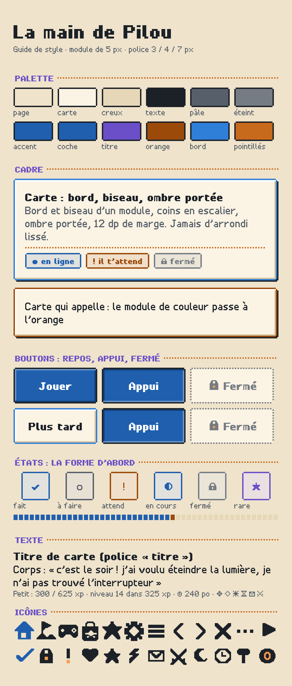

# La main de Pilou — guide de style des interfaces

Une seule écriture visuelle pour tout ce qui n'est pas la scène : fenêtres, menus, cartes, boutons, textes.
Le canon existe, il n'est pas inventé ici : **le menu « Sept portes »** du PC (`apps/PilouBureau/MenuRetro.xaml`,
planche [maquettes/menu/captures/sept-portes.png](maquettes/menu/captures/sept-portes.png)), **la bulle du bureau**
(`FenetrePilou.cs`, `BullePixel.cs`) et **le cadre de l'Aventure** (`CadrePixel`, [SCENES.md](SCENES.md)). Ce guide
les mesure et les écrit. Toute interface nouvelle s'y tient ; tout écart se discute ici d'abord.

| Planche | Image |
|---|---|
| Toutes les pièces, dessinées par le vrai code de l'app (clair) | [captures/style/planche-clair.png](captures/style/planche-clair.png) |
| Les mêmes, de nuit | [captures/style/planche-sombre.png](captures/style/planche-sombre.png) |
| Le jeu d'icônes (1×, à l'écran, dessin fin) | [captures/style/icones.png](captures/style/icones.png) |
| Android avant / après : Accueil, Jouer, Boutique, Collection | [clair](captures/style/avant-apres-clair.png), [sombre](captures/style/avant-apres-sombre.png), [grande police](captures/style/avant-apres-grande-police.png) |
| En-tête et barre du bas en grande police, avant / après | [captures/style/entete-barre-grande-police.png](captures/style/entete-barre-grande-police.png) |



## Les six règles

1. **Tout est en pixels entiers.** Aucun arrondi lissé, aucun dégradé, aucune ombre floue, aucune mise à l'échelle
   non entière. Un coin « rond » est un coin **en escalier** : le pixel du coin manque.
2. **Un seul module.** Cadres, pointillés et marges se comptent en modules `U` (voir « Le module »).
3. **Une seule police : celle de Pilou** ([POLICE.md](POLICE.md)). La police système n'est permise que dans les cas
   listés plus bas.
4. **La forme d'abord, la couleur ensuite.** Chaque état porte un signe de forme (cadre, biseau inversé, coche,
   cadenas, pointillés). Jamais la seule couleur.
5. **Jamais rouge contre vert** (Antoine est deutéranope). Les accents sont le bleu, l'orange et le violet.
6. **Les signes de clavier sont remplacés par des icônes pixel** (voir « Icônes »).

## Le module

| Où | Valeur de `U` | Source |
|---|---|---|
| Menu du PC | 2 unités WPF (2 px à 100 %) | mesuré dans `MenuRetro.xaml` : bords, biseau, pointillés, curseur, coche sont tous dessinés par pas de 2 |
| Bulle du bureau | 3 unités WPF (bord et pointe en escalier) | `FenetrePilou.cs` : `BorderThickness = 3`, pointe `Pixels` de 3 |
| Fenêtre Aventure du PC | 5 unités WPF (le pixel de la scène à ×5) | `CadrePixel.cs`, [SCENES.md](SCENES.md) |
| Téléphone, partout | le pixel de la scène : largeur de l'écran ÷ 192, entier (5 px à 1078 px de large, 3 px à 720) | `Aventure.unite`, repris par `Style.u` |

Sur le téléphone, une seule taille de pixel dans toute l'app : celle de la scène de l'Aventure.

## Palette

Deux thèmes, mêmes rôles. Le thème suit le système sur le téléphone, le thème de Pilou sur le PC.
Les couleurs sont celles de `MenuRetro.cs` ; `page` et `creux` sont les deux seuls ajouts (le menu n'a pas de page).

| Rôle | Clair (crème) | Sombre (nuit) | Sert à |
|---|---|---|---|
| `page` | `#efe3cb` | `#0b0e1a` | fond d'écran derrière les cartes (ajout) |
| `carte` | `#fbf3e4` | `#151a2e` | fond d'un cadre, d'un menu |
| `creux` | `#e6d7b8` | `#2a3156` | cases vides d'une barre, fond d'un groupe d'onglets (ajout) |
| `texte` | `#1c2128` | `#e6ecf2` | texte courant, titres de carte |
| `pâle` | `#57606a` | `#adbac7` | détails, légendes, onglet au repos |
| `éteint` | `#767c84` | `#7d8796` | ce qui est fermé |
| `accent` | `#1f5fae` | `#f69d50` | survol du menu, appui, bouton principal |
| `sur accent` | `#ffffff` | `#151a2e` | texte posé sur l'accent |
| `bord` | `#2f7ed8` | `#6a5acd` | bord d'un cadre |
| `biseau clair` / `sombre` | `#ffffff` / `#d9c7a3` | `#3a4270` / `#0b0e1a` | biseau |
| `ombre` | `#1c2128` | `#0b0e1a` | ombre portée |
| `pointillés` | `#c86a1c` | `#6a5acd` | séparateurs, titres de section |
| `coche` | `#1f5fae` | `#6cb6ff` | ce qui est choisi, fait, en ligne |
| `titre` | `#6a4fc8` | `#9b8cff` | titres de section |
| `orange` | `#9c4a0a` | `#f69d50` | ce qui appelle le joueur, les pièces d'or |

- Tout texte tient un contraste d'au moins 4,5:1 sur `page` et sur `carte` (c'est pourquoi l'orange du thème clair
  est foncé : `#9c4a0a`).
- **Toujours de nuit, dans les deux thèmes** : l'en-tête (niveau, XP, pièces) et la boutique. Ce sont l'en-tête du
  menu du PC et la borne d'arcade ; ils prennent la palette sombre telle quelle.
- La bulle du bureau garde son bord bleu `#6cb6ff` : c'est la voix de Pilou, pas une carte.

## Le cadre

```
 .######################.        # bord (1 U), coins en escalier : le pixel du coin manque
 #++++++++++++++++++++++#x       + biseau clair (haut, gauche)   - biseau sombre (bas, droite)   (1 U)
 #+                    -#x       x ombre portée (1 U, en bas et à droite, en escalier elle aussi)
 #+       fond         -#x
 #+--------------------- #x
 .######################.x
  .xxxxxxxxxxxxxxxxxxxxxx.
```

| Sorte | Fait de | Sert à |
|---|---|---|
| **Plein** | bord 1 U + biseau 1 U + ombre portée 1 U | cartes, panneaux, fenêtres, réplique et choix de l'Aventure |
| **Fin** | bord 1 U + biseau 1 U, sans ombre | boutons, onglets d'un groupe |
| **Plat** | bord 1 U seul, coins en escalier | puces, étiquettes, cases d'état, onglet ouvert de la barre du bas, bulle |
| **Pointillé** | bord en pointillés (1 U allumé, 1 U éteint), ni biseau ni ombre | ce qui est fermé |

- Le contenu d'une carte se retire de 12 dp à l'intérieur du cadre (téléphone) ; 2 à 3 unités dans le menu du PC.
- Entre deux cartes : 14 dp. Marge de page : 18 dp de chaque côté.
- **Carte qui appelle le joueur** (« il t'attend ») : même cadre, le bord passe à l'orange, et le titre porte un signe
  (`!`, `●`, `★`).
- Le menu du PC d'origine a 2 px d'ombre tout autour au lieu d'une ombre portée : c'est le même cadre, vu avant que
  l'Aventure ne le pose sur le téléphone. Les nouvelles fenêtres du PC prennent l'ombre portée (`CadrePixel.cs`).

## Texte

La police est décrite dans [POLICE.md](POLICE.md) : « texte » et « titre » (gras), chacune avec son dessin fin (2×),
choisi quand un pixel de police tombe sur un nombre pair de pixels de l'écran.

| Taille | Téléphone (dp par pixel de police) | Sur 1078 × 2400 | PC | Sert à |
|---|---|---|---|---|
| **Petit** | 1,25 | 3 px | 1,3 unité (bulle) | étiquettes, chiffres, légendes, titres de section, onglets |
| **Corps** | 1,45 (4 ÷ 2,75) | 4 px | 2 unités (réplique de l'Aventure) | phrases, récit, choix, boutons, titres de carte (en « titre ») |
| **Page** | 2,4 | 7 px | — | titre de page, nombre du niveau |

- La taille suit **la taille de police du système** (× 1,3 en « grande police »), puis s'arrondit au pixel entier.
- **Libellés rangés côte à côte** (barre du bas, groupe d'onglets) : ils prennent la plus grande taille qui laisse
  chaque nom dans sa case, avec 2 U d'air de chaque côté. En grande police, ils grandissent donc moins que le reste,
  mais ne se touchent jamais (`Style.pixelQuiTient`).
- **Un texte qui ne tient pas se reformule**, il ne se tronque pas. Quand la longueur dépend de l'écran, on écrit
  plusieurs formes, de la plus longue à la plus courte, et l'écran prend la première qui tient (`Style.choisir`) :
  « ▲ Niveau 15 : Tête, Yeux, Cou +9 · encore 1000 xp » → « ▲ Niveau 15 : Tête, Yeux, Cou +9 » → « ▲ Niveau 15 : 12 rangées ».
- Capitales : seulement les titres de section et les enseignes (« BOUTIQUE »). Le gras (« titre ») : titres et boutons.
- Enseigne : police « titre », ombre d'un pixel de police en bas à droite, dans la couleur du bord.

### Où la police système reste permise

| Cas | Pourquoi |
|---|---|
| Un caractère que la police de Pilou n'a pas (emoji, alphabet non latin) | il est écrit par le système dans sa case de 6 pixels ; le reste de la phrase reste en pixels |
| Les textes venus de l'extérieur et affichés bruts dans une liste longue (Réglages, journal de diagnostic, adresses, codes d'appairage à recopier) | la lecture exacte prime |
| Les champs de saisie et le clavier | ce sont ceux du système |
| Les notifications, le titre de la fenêtre, l'écran de la barre des tâches | le système les dessine |
| Les fenêtres pas encore converties | état provisoire : voir « Où en est-on » |

Le récit de l'Aventure, lui, est **en police pixel** (décision du 28 novembre 2026, `DECISIONS.md`) : à 4 px par
pixel de police sur un téléphone, il reste lisible. Ce guide n'ouvre donc pas d'exception « long texte ».

## États

Le canon est la ligne du menu : au repos, texte sur fond ; survolée, **fond d'accent, texte inversé et curseur ▶** ;
choisie, **coche ✓** (case) ou **rond à point** (choix exclusif) ; fermée, **texte éteint, sans curseur**.
Un écran tactile n'a pas de survol : l'appui le remplace.

| État | Bouton principal | Bouton secondaire, carte | Onglet, option | Signe de forme |
|---|---|---|---|---|
| **Repos** | fond d'accent, texte inversé, biseau en relief | fond de carte, cadre fin (ou plein pour une carte) | texte pâle, sans cadre | — |
| **Survol** (PC) / **appui** | le biseau s'inverse : le bouton s'enfonce | fond d'accent, texte inversé, plus d'ombre portée | idem | biseau inversé, curseur ▶ sur le PC |
| **Choisi** | — | bord à la couleur `coche` | cadre plat à la couleur `coche` autour de lui | le cadre, la coche ✓, le rond à point |
| **Fermé** | texte éteint, cadre en pointillés, cadenas devant le texte | idem | idem | pointillés et cadenas |

Les états d'une chose (quête, session, objet) se disent par une **case** : un carré au cadre plat avec un signe.

| Signe | Sens | Couleur d'appoint |
|---|---|---|
| ✓ | fait, à toi | `coche` |
| ○ | à faire | `pâle` |
| ! | attend le joueur | `orange` |
| ◐ ◒ | en cours | `coche` |
| cadenas | fermé | `éteint` |
| ★ ◆ ◇ ✦ ✺ | raretés | celle de la rareté |

## Titres de section, pointillés, puces

- **Titre de section** : petites capitales, police « titre », taille petit, couleur `titre`, puis des **pointillés
  jusqu'au bord** (3 U après le texte). Menu du PC : marge 9 / 7 / 8 / 2. Téléphone : 12 dp au-dessus, 6 dp au-dessous.
- **Pointillés** : carrés de 1 U, un allumé, un éteint, couleur `pointillés`. Ils séparent deux lignes d'une même
  carte (6 dp au-dessus et au-dessous) ; jamais de filet plein.
- **Puce** (un mot d'état : « ● PC en ligne ») : cadre plat à la couleur de l'état, fond de carte teinté à 12 %,
  texte « titre » petit, toujours avec un signe devant.
- **Barre de progression** : cases de 3 U séparées de 1 U, hautes de 4 U (3 U dans l'en-tête) ; pleines en bleu, la
  dernière pleine en orange, les vides en `creux`. Jamais de barre lisse.

## Icônes

Générées comme les sprites : `outils/sprites/icones.py`, appelé par `generer.py`, écrit `assets/sprites/ui-*.txt`,
`signe-*.txt`, leur dessin fin dans `assets/sprites2x/`, et la table `assets/signes.txt`.

```
python3 outils/sprites/generer.py     # écrit aussi les icônes
python3 outils/sprites/icones.py      # planche de contrôle : outils/sprites/planches/icones.png
```


| Famille | Grille | Sert à | Exemples |
|---|---|---|---|
| `ui-<nom>` | 12 × 12 | l'icône seule : onglet, bouton, tête de carte | accueil, aventure, jouer, boutique, collection, reglages, menu (☰), retour (‹), suite (›), fermer, plus (⋯), curseur (►), coche, cadenas, nouveau |
| `signe-<nom>` | 7 × 7 | le signe dans une ligne de texte, à la hauteur des capitales | ensemble (❖), losange (◇), sablier, lettre, roue (⚙), attente, quart, demi… |

- **Deux couleurs** : l'encre, que l'interface teinte selon l'état, et un accent orange qui reste tel quel.
- Dans un texte en police pixel, un signe de clavier qui a son sprite (table `assets/signes.txt`) est **dessiné par
  ce sprite**, automatiquement ; ceux que la police possède déjà (♥ ★ ✓ ▲ ▼ ▶ ● ○ ■ → ¤…) restent ses glyphes.
  Les doublons de clavier sont ramenés au même dessin (`►` devient `▶`, `✕` devient `✗`, `⇢` devient `→`).
- La pièce d'or s'écrit `¤` dans un texte, jamais `◉` (réservé au rayon « Yeux »).
- Une icône ne porte jamais seule un sens important : un libellé ou une description l'accompagne.

## En-tête et barre du bas (téléphone)

| Élément | Règle |
|---|---|
| En-tête | fond nuit, liseré violet de 1 U en bas sur toute la largeur ; pastille de niveau au cadre violet de 1 U (« NIV » petit, nombre en « titre ») ; titre en « titre » petit ; barre d'XP en cases de 3 U ; chiffres en petit ; pièces d'or en « titre » corps, orange ; la prochaine rangée de la boutique sur toute la largeur, en violet |
| Roue des Réglages | icône `ui-reglages` posée sur l'en-tête, 48 dp de toucher ; ouverte : cadre plat orange autour d'elle |
| Barre du bas | fond de carte, liseré de 1 U à la couleur `bord` ; cinq onglets ; icône 12 × 12 à 2 dp le pixel ; libellé en petit |
| Onglet ouvert | cadre plat à la couleur `coche` autour de l'icône, icône et libellé à la couleur `coche` |
| Pastille « ! » | carré orange au cadre plat encre, en haut à droite de l'icône |

## Dans le code

| | PC | Téléphone |
|---|---|---|
| Cadre | `CadrePixel.cs`, `MenuRetro.xaml` | `Style.Cadre` (`plein`, `fin`, `plat`, `pointille`), `CadrePixel.java` sous la scène |
| Texte | `TextePixel.cs` | `Style.Texte` (un `TextView` dessiné en police pixel), `TextePixelVue` |
| Palette | `MenuRetro.cs` (clés « Menu… »), `CadrePixel.cs` | `Style.CLAIRE`, `Style.SOMBRE`, `Style.NUIT` |
| Pièces | — | `Style.carte`, `bouton`, `puce`, `caseSigne`, `titreSection`, `separateur`, `Barre`, `Icone`, `chevron` |
| Planche de contrôle | `--essai=menu` | `CapturesStyleTest` : `app/build/captures/style/` (1078 × 2400 à 440 dpi ; clair, sombre, grande police) |

Sur le téléphone, on ne crée plus de fond arrondi (`GradientDrawable`, `Ui.arrondi`), plus d'ombre du système
(`setElevation`), plus d'onde au toucher (`RippleDrawable`), plus d'agrandissement non entier sous le doigt.

## Où en est-on

| Écran | État |
|---|---|
| PC : menu « Sept portes », bulle, fenêtre Aventure | au guide |
| PC : boutique, soins, réglages, journal, les autres fenêtres | à faire (chantier suivant) |
| Téléphone : en-tête, barre du bas, Accueil, Jouer, Boutique, Collection, « Rangées débloquées » | au guide (28 novembre 2026) |
| Téléphone : lecture de l'Aventure | au guide (chantier « style pixel de l'Aventure ») |
| Téléphone : liste des aventures, Réglages, épreuves, atelier, installation, bulle flottante, widget | couleurs du guide ; cadres et police encore ceux du système |

Restes connus, à trancher :

- Deux classes de cadre vivent côte à côte sur le téléphone (`Style.Cadre`, `CadrePixel.java`) : même dessin, même
  module, à fondre en une seule une fois les deux chantiers fusionnés.
- Les **bulles vendues en boutique** ont un rayon d'arrondi (`Boutique.style`, `StyleBulle.rayon`) et l'aperçu des
  titres est écrit en italique système : ce sont des objets du catalogue, communs au PC ; les passer en escalier est
  une décision de produit.
- Les icônes des jeux de l'atelier (`Ui.PECHE`, `Ui.CUISINE`…) sont déjà en pixels mais vivent encore dans le code
  Java ; elles rejoindront la banque de sprites.
- Jamais vu sur un vrai téléphone : toutes les mesures viennent de captures Robolectric au format 1078 × 2400.
