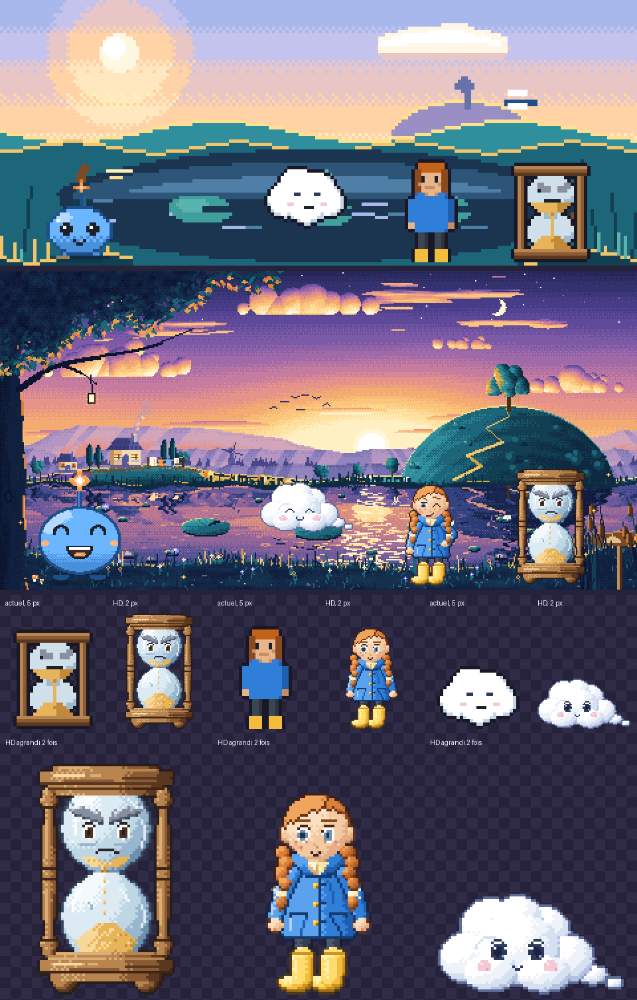

# Personnages en haute définition : planche d'essai

Essai du 28 novembre 2026, à valider avant de dessiner les 29 personnages et les acteurs. Trois natures : un objet
(Grumeau), une humaine (Lison), un nuage (Brouillon).

- **Statut : essai dessiné, pas encore exporté dans `assets/`** (le format attend `docs/SCENES-HD.md`).
- Rien n'a tourné dans l'application : ce sont des images de l'outil de planches.
- À regarder d'abord : [essai.png](essai.png).



## Ce que montre la planche

| Bande | Contenu |
|---|---|
| Haut | La scène actuelle : 192 × 80 unités à 5 px, avec les trois personnages en pied d'aujourd'hui |
| Milieu | La scène HD : décor d'étude C (480 × 240 unités à 2 px), Pilou fin (96 × 112) et les trois nouveaux dessins |
| Bas | Chaque personnage : actuel à sa taille d'écran, nouveau à sa taille d'écran, nouveau agrandi deux fois |

| Personnage | Taille (unités) | Planche de toutes ses images | GIF |
|---|---|---|---|
| Grumeau | 52 × 87 | [grande-panne-grumeau.png](grande-panne-grumeau.png) | [gif](grande-panne-grumeau.gif) |
| Lison | 40 × 76 | [phare-eteint-lison.png](phare-eteint-lison.png) | [gif](phare-eteint-lison.gif) |
| Brouillon, le petit nuage | 70 × 38, à 24 unités du sol | [petit-nuage-brouillon.png](petit-nuage-brouillon.png) | [gif](petit-nuage-brouillon.gif) |

Chaque planche : une ligne par humeur, sept images (repos, inspiré, yeux mi-clos, yeux fermés, parole 1 à 3), à la
taille d'écran (2 px par unité, sans lissage).

## Ce que la nouvelle unité apporte

| | Actuel | Haute définition |
|---|---|---|
| Grumeau | portrait 32 × 32 repris tel quel | fuseaux tournés, plateaux moulurés, pieds en boule, verre en volume avec reflets et rayures, sable qui file en pointillés, grumeau au col, sourcils de crin hérissés, cernes ; dents serrées en colère |
| Lison | silhouette de rectangles, 22 × 33 | visage (iris pâles, cils, sourcils, taches de son, joues), nattes tressées et nouées, ciré avec patte, brandebourgs, poches et reflets, mains, bottes trop grandes ; une pose de bras par humeur |
| Brouillon | portrait 32 × 32 repris tel quel | bosses en volume, ventre tramé, volutes, grands yeux à deux éclats, traîne de deux flocons ; il se ramasse et tremble quand il a peur, une vraie goutte quand il est triste |

Chaque humeur change une forme, pas seulement une couleur : sourcils, paupières, bouche, bras, goutte.

## Comment c'est fait

- `outils/sprites/pinceau_hd.py` : la feuille et ses pinceaux (Python pur). Volumes éclairés d'en haut à gauche,
  rampes de trois à cinq tons, trame ordonnée seulement au passage d'un ton à l'autre, cerne teinté par matière.
- `outils/sprites/personnages_hd.py` : les personnages, une fonction par personnage, un état (humeur, paupières,
  bouche, souffle, phase).
- `outils/sprites/planches_personnages_hd.py` : les planches et les GIF (Pillow, outil de contrôle seulement).

```bash
py outils/sprites/planches_personnages_hd.py          # tout, dans docs/maquettes/personnages
py outils/sprites/planches_personnages_hd.py essai    # la planche d'essai seule
```

## Questions pour le pilote

1. **La main convient-elle ?** Style, niveau de détail, cerne teinté, quantité de trame.
2. **Échelle face à Pilou.** Le Pilou fin (corps d'environ 62 unités de haut) est plus grand, par rapport aux humains,
   que le mini-Pilou d'aujourd'hui : Lison fait 76 unités, un adulte en ferait 100 à 110. À confirmer avec le moteur.
3. **Proportions des humains.** Lison a une grande tête (trois têtes de haut), comme un personnage de livre d'images.
   Les adultes suivraient la même famille (quatre têtes environ).

## Restes connus

- Les légendes de la planche sont en police système (planche de contrôle, pas une ressource).
- Entrée en scène et sautillement sont des mouvements du moteur : aucune image dédiée pour l'instant.
- Le sable du haut de Grumeau est mince ; la main levée de Lison se lit encore comme un poing à 2 px.
